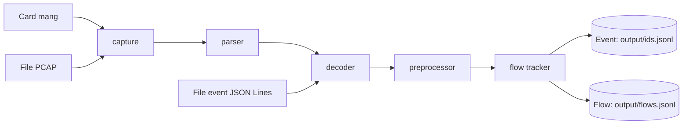
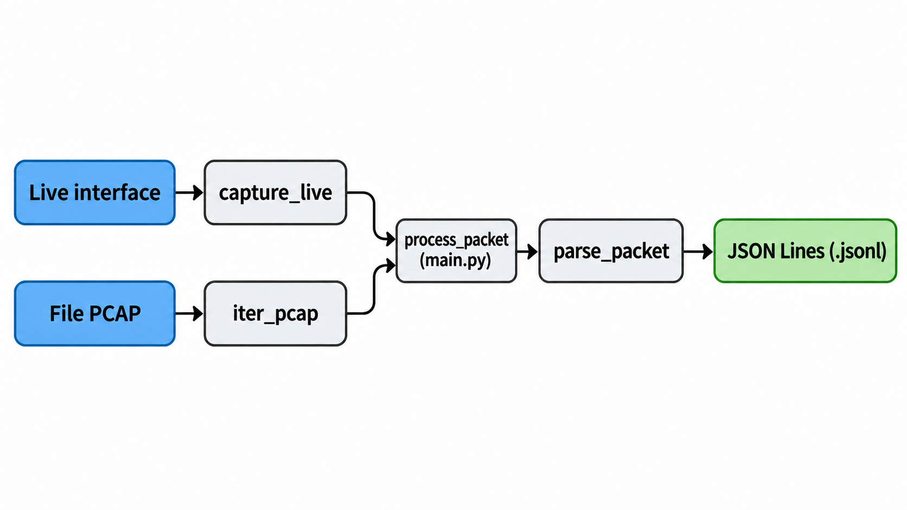

# Hệ thống IDS - Capture, Parser, Decoder, Preprocessor & Flow Tracker

- Chương trình Python thu thập gói tin từ **card mạng đang hoạt động** hoặc **file PCAP** (hoặc đọc **event có sẵn** từ file JSON Lines), phân tích IPv4, TCP/UDP, HTTP/1.x, DNS, SMTP, giải mã dữ liệu ứng dụng, kiểm tra và chuẩn hóa event, rồi gom các gói thành **flow hai chiều**. Kết quả được ghi thành **JSON Lines - mỗi dòng một JSON**: một file event (mỗi gói một dòng) và một file tổng kết flow (mỗi flow một dòng).

> Repository dùng cho toàn bộ đồ án IDS. Mỗi bài tập thêm module vào **cùng một luồng xử lý**; mã nguồn được chia theo module chức năng, không chia theo bài tập.



| Bài tập | Nội dung | Module | Kiểm thử |
| --- | --- | --- | --- |
| 1 | Packet Capture & Parser | [capture](src/capture/README.md), [parser](src/parser/README.md), [output](src/output/README.md) | 12 ca bắt buộc + bắt gói thật trên Wi-Fi |
| 2 | Decoder, Preprocessor & Flow/Connection Tracker | [decoder](src/decoder/README.md), [preprocessor](src/preprocessor/README.md), [flow](src/flow/README.md), [pipeline](src/pipeline.py), [config](src/config.py) | 14 ca bắt buộc T01–T14 + kiểm thử tự động từng module |

Ví dụ: với một gói HTTP GET có URI `/search?q=%27%20OR%201%3D1`, chương trình cho biết IP/port, method, header như Bài tập 1, đồng thời giải mã URI thành `/search?q=' OR 1=1`, chuẩn hóa tên header, gắn gói vào đúng flow và cập nhật thống kê của flow đó.

## 1. Các chức năng hiện tại

### Bài tập 1 - Packet Capture & Parser

| Yêu cầu trong đề | Chức năng đã triển khai |
| --- | --- |
| Live capture | Liệt kê và chọn interface; bắt từng gói, giữ timestamp và chuyển ngay sang parser. Có giới hạn số gói/thời gian và dừng bằng Ctrl+C. |
| Import PCAP | Đọc lần lượt các gói trong file PCAP, giữ timestamp đã lưu và dùng **cùng parser với live capture**. |
| Phân tích IPv4 | Lấy IP nguồn/đích, phiên bản, TTL, protocol, tổng độ dài và thông tin phân mảnh. |
| Phân tích TCP/UDP | TCP: port, sequence, acknowledgment, flags, window và độ dài payload. UDP: port, độ dài datagram và payload. |
| Phân tích HTTP/1.x | Request: method, URI, version, headers, body. Response: version, status code, reason, headers, body. |
| Phân tích DNS | Transaction ID, query/response, response code, tên miền và loại truy vấn; tên, loại và dữ liệu của các answer. |
| Phân tích SMTP | Lệnh `HELO`, `EHLO`, `MAIL FROM`, `RCPT TO`; mã và nội dung phản hồi như `250 OK`. Từ Bài tập 2 có thêm nội dung thư gửi sau lệnh `DATA`. |
| Nhận diện ứng dụng ngoài port chuẩn | Nhận diện HTTP và lệnh SMTP theo payload. Ca HTTP GET sử dụng port **8088**. DNS vẫn dựa vào port 53; phản hồi SMTP và nội dung thư dùng port 25/587 làm tín hiệu bổ trợ. |
| Output chuẩn hóa và logging | Tạo dictionary có cấu trúc thống nhất, ghi ra file JSON Lines và flush sau mỗi event. |
| Xử lý dữ liệu lỗi | Ghi trạng thái/lỗi theo từng gói; có kiểm thử giao thức lạ, header sai/thiếu, payload rỗng/không decode được và dữ liệu thiếu. Giới hạn còn lại được nêu ở mục 6. |

### Bài tập 2 - Decoder, Preprocessor & Flow/Connection Tracker

| Yêu cầu trong đề | Chức năng đã triển khai |
| --- | --- |
| Xử lý lỗi an toàn | Mỗi bước tự bắt lỗi của mình; gói/event lỗi vẫn được ghi kèm trạng thái và lý do, chương trình chạy tiếp gói sau. Khi nguồn lỗi hoặc người dùng nhấn Ctrl+C, các flow còn mở vẫn được ghi ra. |
| Cấu hình được | Thời gian chờ TCP/UDP, giới hạn kích thước, số flow tối đa và chính sách bỏ event đặt trong file JSON (`--config`), xem [mục Cấu hình](#cấu-hình). |
| Decoder: HTTP URL/percent decoding, form | Giải mã `%XX` trong URI, tham số và body `application/x-www-form-urlencoded`, chỉ **một lượt**; URI gốc giữ nguyên. Ví dụ `%27%20OR%201%3D1` → `' OR 1=1`. |
| Decoder: HTML entity | Đổi `&lt;script&gt;` → `<script>` (và các thực thể khác) trong nội dung dạng chữ của HTTP và phần text/html của thư; JSON, form, dữ liệu nhị phân giữ nguyên. |
| Decoder: SMTP/MIME Base64, Quoted-Printable | Parser nhận diện nội dung thư sau lệnh `DATA`; decoder giải mã từng phần MIME theo header `Content-Transfer-Encoding`, giải mã Subject dạng `=?utf-8?b?...?=`, lưu body/trường đã giải mã cùng `decode_status` của thư và của từng phần. |
| Decoder: ASCII và UTF-8 | Đọc chữ theo `charset` khai báo (mặc định UTF-8, bao gồm ASCII); byte không hợp lệ được thay bằng `�`, ghi lỗi kèm vị trí, không crash. |
| Preprocessor: Validation | Kiểm tra trường bắt buộc, port 0–65535, các trường số của IP/TCP/UDP, timestamp, giao thức; gắn `valid` / `partial` / `invalid`. |
| Preprocessor: Normalization | Chuẩn hóa tên giao thức, IP, tên miền, tên header HTTP, timestamp (số giây Unix) và URI ở mức an toàn (`uri_normalized`). |
| Preprocessor: Missing/unsupported data | Trường thiếu được điền `null` / `[]` / `{}` nhất quán; dữ liệu chưa hỗ trợ được đánh dấu, hoặc bỏ hẳn nếu cấu hình yêu cầu. |
| Preprocessor: Metadata | Thêm `preprocess_status`, `processing_action` và `reason`. |
| Flow: nhận diện flow và chiều gói | Khóa 5-tuple hai chiều (A→B và B→A cùng một flow), `flow_id` ổn định, `direction` theo bên gửi gói đầu tiên. |
| Flow: TCP connection tracking | Trạng thái `NEW` → `HANDSHAKE` → `ESTABLISHED` → `CLOSING` → `CLOSED`, hoặc `RESET`; dựa vào cờ SYN, ACK, FIN, RST, xử lý cả gói không có payload. |
| Flow: UDP và idle timeout | UDP gom theo 5-tuple hai chiều trong thời gian chờ; flow TCP/UDP hết hạn được ghi ra và xóa khỏi bảng flow đang hoạt động, kể cả khi bắt live mà mạng im lặng. |
| Flow: thống kê | `flow_id`, `protocol`, `application_protocol`, endpoint A/B, `start_time`, `last_seen`, `duration`, số gói/byte tổng và theo từng chiều, `SYN_count`, `ACK_count`, `FIN_count`, `RST_count`, `state`. |

## 2. Cài đặt và chạy thử

- Yêu cầu **Python 3.10 trở lên**. Thư viện chính là Scapy; pytest dùng cho kiểm thử. Các lệnh dưới đây chạy bằng PowerShell tại thư mục gốc repository, nơi có `main.py`.

```powershell
python -m venv .venv
.venv\Scripts\Activate.ps1
python -m pip install -r requirements.txt
```

### Chạy với PCAP kiểm thử có sẵn

- Không cần bắt lưu lượng thật để thử. Ví dụ với phiên TCP đầy đủ của ca T13:

```powershell
python main.py --pcap TEST/integration/required_cases/t13_flow_statistics/input.pcap --output output/demo_events.jsonl --flow-output output/demo_flows.jsonl
Get-Content output/demo_flows.jsonl | ConvertFrom-Json
```

Kết quả: `output/demo_events.jsonl` có 10 dòng (mỗi gói một event, có `flow_state` sau từng gói), `output/demo_flows.jsonl` có 1 dòng tổng kết flow: 10 gói, 767 byte, 2 SYN, 9 ACK, 2 FIN, `state` là `CLOSED`, `end_reason` là `tcp_closed`.

Xem phần giải mã của ca T01 (URI có percent-encoding):

```powershell
python main.py --pcap TEST/integration/required_cases/t01_http_url_decode/input.pcap --output output/t01_demo.jsonl --flow-output output/t01_demo_flows.jsonl
Get-Content output/t01_demo.jsonl | ForEach-Object { ($_ | ConvertFrom-Json).decoded.uri }
```

Kết quả cần thấy: `/search?q=' OR 1=1&lang=vi+en&next=%27` và `/login`.

### Chạy với file event JSON Lines

Dùng `--events` để đưa event có sẵn (mỗi dòng một event cùng cấu trúc với event của parser) qua Decoder, Preprocessor và Flow Tracker, ví dụ event thiếu hoặc sai trường:

```powershell
python main.py --events TEST/integration/required_cases/t14_malformed_event/input.jsonl --output output/t14_demo.jsonl --flow-output output/t14_demo_flows.jsonl
```

Dòng hỏng (không phải JSON, sai kiểu dữ liệu...) không làm dừng chương trình; mỗi dòng vẫn có một event kèm `preprocess_status` và `reason`.

### Bắt gói trực tiếp từ card mạng

Trên Windows, cần cài **Npcap** và có quyền bắt gói trên interface được chọn.

```powershell
python main.py --list-interfaces
python main.py --interface "Wi-Fi" --count 100 --timeout 30 --output output/live_demo.jsonl --flow-output output/live_flows.jsonl
```

Thay `Wi-Fi` bằng tên interface trên máy. Lệnh dừng khi bắt đủ 100 gói hoặc hết 30 giây. Có thể nhấn **Ctrl+C** để dừng sớm; kết quả đã ghi vẫn được giữ, các flow còn mở được ghi ra với lý do `interrupted`. Trong lúc bắt, cứ mỗi `live_check_interval` giây chương trình kiểm tra và ghi ra các flow đã hết hạn, kể cả khi mạng im lặng.

### Chế độ chỉ phân tích (như Bài tập 1)

Thêm `--parse-only` để chỉ capture và parse, không giải mã, không chuẩn hóa, không theo dõi flow. Event có đúng cấu trúc của Bài tập 1 và không tạo file flow; các ca kiểm thử của Bài tập 1 dùng chế độ này để chạy lại.

```powershell
python main.py --pcap TEST/integration/required_cases/http_get/input.pcap --output output/http_get_demo.jsonl --parse-only
```

Luồng xử lý ở chế độ này giữ nguyên như Bài tập 1:



### Các tham số dòng lệnh

| Tham số | Ý nghĩa |
| --- | --- |
| `--list-interfaces` | Liệt kê interface rồi thoát. |
| `--interface "<tên>"` | Chọn nguồn live capture. |
| `--pcap <đường-dẫn>` | Chọn nguồn file PCAP. |
| `--events <đường-dẫn>` | Chọn nguồn file event JSON Lines (không dùng chung với `--parse-only`). |
| `--output <đường-dẫn>` | File event đầu ra; mặc định `output/ids.jsonl`. Thư mục cha được tạo nếu chưa có. |
| `--flow-output <đường-dẫn>` | File tổng kết flow; mặc định `output/flows.jsonl`. |
| `--config <đường-dẫn>` | File cấu hình JSON; không truyền thì dùng giá trị mặc định. |
| `--parse-only` | Chỉ capture và parse như Bài tập 1. |
| `--count N` | Số gói live tối đa; mặc định `0` là không giới hạn. |
| `--timeout N` | Thời gian live tối đa tính bằng giây; phải lớn hơn 0. Không truyền thì không giới hạn thời gian. |

Mỗi lần chạy chọn **một** nguồn: `--interface`, `--pcap` hoặc `--events`. `--count` và `--timeout` chỉ áp dụng cho live capture. Đường dẫn tương đối được tính từ thư mục đang chạy lệnh. File kết quả không được trùng file đầu vào hay trùng nhau; chương trình báo lỗi và thoát trước khi tạo file.

Mã thoát: `0` xử lý xong; `2` tham số hoặc cấu hình sai; `1` nguồn dữ liệu hoặc việc ghi file có lỗi; `130` người dùng nhấn Ctrl+C.

**Lưu ý:** chương trình ghi nối tiếp vào file kết quả. Dùng tên file mới cho mỗi lần thử nếu muốn xem riêng kết quả; chạy lại cùng tên sẽ thêm dòng vào cuối file.

### Cấu hình

File [config/default.json](config/default.json) ghi đủ các tùy chọn với giá trị mặc định. File cấu hình riêng chỉ cần ghi tùy chọn muốn đổi, ví dụ `{"udp_idle_timeout": 5}`. Tên tùy chọn lạ hoặc giá trị sai kiểu bị báo lỗi ngay khi chạy.

| Tùy chọn | Mặc định | Ý nghĩa |
| --- | --- | --- |
| `tcp_idle_timeout` | `120` | Flow TCP không có gói mới sau bấy nhiêu giây thì hết hạn. |
| `udp_idle_timeout` | `30` | Như trên, cho flow UDP. |
| `live_check_interval` | `1` | Khi bắt live: cứ bấy nhiêu giây kiểm tra flow hết hạn một lần, kể cả lúc mạng im lặng. |
| `max_active_flows` | `100000` | Số flow giữ cùng lúc tối đa; đầy thì đóng flow lâu nhất không có gói mới (`table_full`). |
| `max_payload_bytes` | `65536` | Decoder chỉ đọc tối đa bấy nhiêu byte dữ liệu của mỗi gói. |
| `max_mime_parts` | `50` | Số phần tối đa được giải mã trong một thư MIME. |
| `max_event_bytes` | `1048576` | Độ dài tối đa của một dòng khi đọc file event (`--events`). |
| `drop_invalid_events` | `false` | `true`: bỏ hẳn event `invalid` (không ghi ra file); `false`: vẫn ghi kèm lý do. |
| `drop_unsupported_events` | `false` | `true`: bỏ hẳn event chưa hỗ trợ (ICMP, ARP, gói phân mảnh...); `false`: vẫn ghi kèm lý do. |

## 3. Đọc kết quả đầu ra

### File event

Mỗi event gồm các trường của Bài tập 1, rồi tới các trường do từng bước của Bài tập 2 thêm vào, luôn theo cùng một thứ tự:

| Trường | Do bước nào thêm | Nội dung |
| --- | --- | --- |
| `packet_id`, `timestamp`, `source`, `captured_length` | Parser | Số thứ tự gói, thời điểm (số giây Unix), nguồn `live`/`pcap`, độ dài gói đã thu nhận (byte). |
| `network`, `transport`, `application` | Parser (Preprocessor chuẩn hóa) | Các trường IPv4, TCP/UDP và ứng dụng. Phần ứng dụng có đủ khung trường của giao thức; HTTP có thêm `uri_normalized`. |
| `status`, `errors` | Parser | Trạng thái phân tích và danh sách lỗi của parser. |
| `decoded`, `decode_status`, `decode_errors` | [Decoder](src/decoder/README.md) | Dữ liệu sau khi giải mã, trạng thái và lỗi giải mã. |
| `preprocess_status`, `processing_action`, `reason` | [Preprocessor](src/preprocessor/README.md) | Kết luận kiểm tra, việc làm tiếp với event và lý do. |
| `flow_id`, `direction`, `flow_state` | [Flow Tracker](src/flow/README.md) | Flow chứa gói, chiều gói (`forward`/`backward`), trạng thái TCP sau gói này. |

Dưới đây là **phần trích** event đầu tiên của ca T01, xuống dòng để dễ đọc. File JSON Lines thực tế lưu mỗi event đầy đủ trên một dòng:

```json
{
  "packet_id": 1,
  "timestamp": 1700000000.0,
  "source": "pcap",
  "application": {
    "protocol": "HTTP",
    "message_type": "request",
    "method": "GET",
    "uri": "/search?q=%27%20OR%201%3D1&lang=vi%2Ben&next=%2527",
    "uri_normalized": "/search?q=%27%20OR%201%3D1&lang=vi%2Ben&next=%2527",
    "headers": { "host": "shop.example.test" }
  },
  "status": "ok",
  "decoded": {
    "uri": "/search?q=' OR 1=1&lang=vi+en&next=%27",
    "query": [["q", "' OR 1=1"], ["lang", "vi+en"], ["next", "%27"]]
  },
  "decode_status": "ok",
  "preprocess_status": "valid",
  "processing_action": "process",
  "reason": [],
  "flow_id": "d708470a798cb5d1",
  "direction": "forward",
  "flow_state": "ESTABLISHED"
}
```

Ý nghĩa các trạng thái:

| Trường | Giá trị |
| --- | --- |
| `status` (parser) | `ok`: parser ứng dụng trả được kết quả (không có nghĩa gói an toàn); `unknown`: chưa nhận diện ứng dụng hoặc không có IPv4 (gói TCP bắt tay hợp lệ cũng có thể là `unknown`); `partial`: dữ liệu thiếu hoặc cách đóng gói chưa hỗ trợ; `malformed`: đầu vào không hợp lệ hoặc lỗi khi phân tích. |
| `decode_status` | `ok`, `partial` (có kết quả nhưng gặp lỗi), `error` (không giải mã được phần nào), `not_applicable` (không có gì cần giải mã). |
| `preprocess_status` | `valid`, `partial` (dùng được nhưng thiếu hoặc chưa hỗ trợ), `invalid` (thiếu/sai trường bắt buộc). |
| `processing_action` | `process` (đưa vào Flow Tracker), `skip` (ghi event nhưng không theo dõi flow), `drop` (bỏ hẳn event theo cấu hình). |
| `flow_state` | `NEW`, `HANDSHAKE`, `ESTABLISHED`, `CLOSING`, `CLOSED`, `RESET` với TCP; `null` với UDP và với event không theo dõi flow. |

`packet_id` bắt đầu từ 1 ở mỗi lần chạy, không phải mã duy nhất giữa nhiều lần chạy. Timestamp lấy từ gói live hoặc từ PCAP, không phải thời điểm ghi file.

### File flow

Mỗi dòng là bản tổng kết của một flow, được ghi khi flow kết thúc. Ví dụ flow của ca T13:

```json
{
  "flow_id": "d708470a798cb5d1", "protocol": "TCP", "application_protocol": "HTTP",
  "endpoint_a": { "ip": "192.0.2.10", "port": 40000 },
  "endpoint_b": { "ip": "192.0.2.20", "port": 80 },
  "start_time": 1700000000.0, "last_seen": 1700000000.32, "duration": 0.32,
  "packet_count": 10, "byte_count": 767,
  "forward_packet_count": 6, "forward_byte_count": 479,
  "backward_packet_count": 4, "backward_byte_count": 288,
  "SYN_count": 2, "ACK_count": 9, "FIN_count": 2, "RST_count": 0,
  "state": "CLOSED", "handshake_observed": true, "end_reason": "tcp_closed"
}
```

- `endpoint_a` là bên gửi gói đầu tiên; `forward` là chiều A → B, `backward` là chiều B → A.
- `byte_count` cộng `captured_length` của các gói (độ dài khung bắt được, giống cột Length của Wireshark).
- Với UDP, `state`, `handshake_observed` và bốn bộ đếm cờ TCP là `null`.
- `end_reason` cho biết vì sao flow kết thúc: `tcp_closed`, `tcp_reset`, `idle_timeout`, `new_connection`, `table_full`, `end_of_input`, `capture_stopped`, `interrupted`, `source_error`. Chi tiết trong [README Flow Tracker](src/flow/README.md#khi-nào-flow-kết-thúc).

## 4. Kiểm thử theo yêu cầu của task

Thư mục [required_cases](TEST/integration/required_cases/README.md) lưu kết quả các ca bắt buộc, mỗi ca một thư mục gồm đầu vào, giá trị mong đợi, kết quả chương trình ghi ra, kết quả đối chiếu và README riêng:

- **Bài tập 1 - 12 ca:** TCP handshake, TCP data, UDP, HTTP GET/POST/response, DNS query/response, SMTP command/response, giao thức không hỗ trợ và packet không hợp lệ. Bắt gói thật trên Wi-Fi nằm trong [live_capture](TEST/integration/live_capture/README.md).
- **Bài tập 2 - 14 ca T01–T14:** HTTP URL decode, HTML entity, SMTP Base64/QP, invalid bytes, normalization, missing field, TCP handshake, bidirectional flow, TCP close, UDP query/response, concurrent flows, idle timeout, statistics, malformed event. Cả 14 ca đều **ĐẠT**.

Chạy toàn bộ kiểm thử tự động (kiểm tra từng module, chạy lại 14 ca T01–T14, và kiểm tra kết quả đã lưu của cả 26 ca vẫn tái hiện được):

```powershell
python -m pytest
```

Tạo lại kết quả một ca của Bài tập 2, ví dụ T07: `python TEST/integration/run_required_cases.py --case T07 --overwrite`. Bố cục thư mục kiểm thử và cách dùng script xem [TEST/README.md](TEST/README.md).

Có thể chạy lại từng ca bằng `main.py` theo lệnh ghi trong README của ca đó, ví dụ ca idle timeout dùng cấu hình riêng:

```powershell
python main.py --pcap TEST/integration/required_cases/t12_flow_idle_timeout/input.pcap --config TEST/integration/required_cases/t12_flow_idle_timeout/config.json --output output/t12_events.jsonl --flow-output output/t12_flows.jsonl
```

## 5. Tổ chức mã nguồn

Hai nguồn gói tin (live, PCAP) dùng chung hàm `process_packet` trong `main.py` để đánh số gói rồi đưa vào [pipeline](src/pipeline.py). Pipeline chạy lần lượt **parser → decoder → preprocessor → flow tracker**; nguồn file event bỏ qua bước parser. `main.py` ghi event vào file event và tổng kết flow vào file flow.

```text
main.py                     Nhận tham số, chọn nguồn, nối các module, ghi kết quả
config/default.json         Cấu hình mẫu, bằng giá trị mặc định
pytest.ini                  Cấu hình chạy pytest
src/
  config.py                 Đọc và kiểm tra cấu hình
  pipeline.py               Nối parser → decoder → preprocessor → flow tracker, cô lập lỗi từng bước
  capture/                  Liệt kê interface, bắt live, đọc PCAP, đọc file event
  parser/                   Phân tích giao thức và tạo event
  decoder/                  Giải mã URI/form, thực thể HTML, thư MIME, bảng mã
  preprocessor/             Kiểm tra, chuẩn hóa event, gắn trạng thái xử lý
  flow/                     Gom flow hai chiều, trạng thái TCP, thời gian chờ, thống kê
  output/                   Ghi JSON Lines
TEST/                       Kiểm thử theo module và kết quả các ca bắt buộc
requirements.txt            Thư viện cần cài
data/                       Nơi đặt PCAP đầu vào của người dùng
output/                     Nơi lưu kết quả chạy
```

Mỗi thư mục trong `src/` có README riêng giải thích cách hoạt động của module.

## 6. Giới hạn hiện tại

- Phân tích từng gói riêng lẻ, chưa ghép TCP stream hoặc tái lắp IPv4 phân mảnh. HTTP hoặc thư trải trên nhiều gói chỉ được đọc và giải mã phần nằm trong từng gói; gói IPv4 phân mảnh không được theo dõi flow.
- Chưa giải mã TLS/HTTPS, chưa giải nén body `gzip`/`deflate`, chưa ghép HTTP `chunked`. DNS/TCP chỉ đọc thông điệp đầu tiên trong gói; lệnh/phản hồi SMTP chỉ đọc dòng đầu.
- DNS vẫn cần port 53; phản hồi SMTP và nội dung thư cần port 25 hoặc 587. Chưa nhận diện mọi giao thức ứng dụng trên mọi port.
- Parser mới đọc IPv4; event IPv6 chỉ có thể đưa vào qua `--events`.
- Trạng thái TCP chỉ dựa vào cờ và chiều gói, không xác minh số sequence/acknowledgment; gói đến ngay sau khi kết nối đã đóng mở một flow mới rất ngắn.
- `flow_id` chỉ dùng để phân biệt flow trong một lần chạy (chạy lại cùng dữ liệu cho cùng ID).
- Chỉ hỗ trợ PCAP, chưa hỗ trợ PCAPNG. Nếu file PCAP bị cắt giữa header hoặc dữ liệu record, chương trình báo lỗi, dừng đọc file và thoát với mã `1`; event đã ghi được giữ và các flow còn mở được ghi ra với lý do `source_error`.

## 7. Khai báo sử dụng AI

### AI trong Bài tập 1

- **Công cụ:** OpenAI Codex.
- **Mục đích:** hỗ trợ viết, rà soát mã nguồn; bổ sung mô tả hàm; biên soạn README.
- **Phần mã nguồn có AI hỗ trợ:** `main.py`, `src/capture/interfaces.py`, `src/capture/live.py`, `src/capture/pcap.py`, `src/parser/packet.py`, `src/parser/utils.py` và `src/output/jsonl.py`. Trong lần cập nhật đó, AI hỗ trợ rà soát và bổ sung docstring ở các file trên.

### AI trong Bài tập 2

- **Công cụ:** OpenAI Codex.
- **Mục đích:** hỗ trợ thiết kế, viết và rà soát mã nguồn; viết kiểm thử và script tạo kết quả kiểm thử; biên soạn tài liệu.
- **Phần mã nguồn có AI hỗ trợ:** `main.py`, `src/config.py`, `src/pipeline.py`, `src/capture/events.py`, `src/capture/live.py`, phần bổ sung trong `src/parser/packet.py`, các module `src/decoder/`, `src/preprocessor/`, `src/flow/`, và các file kiểm thử trong `TEST/`.
