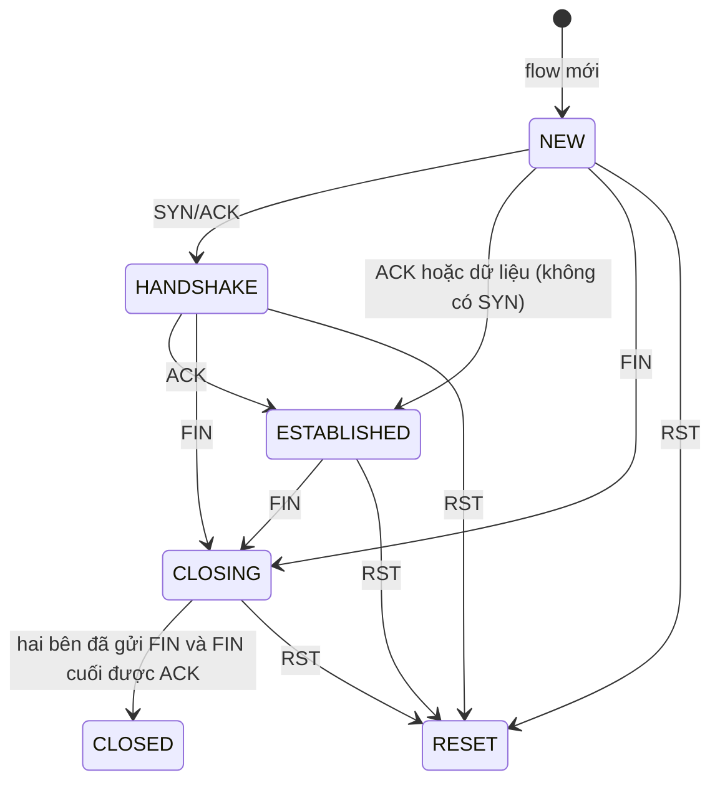

# Flow Tracker - Gom gói tin thành flow hai chiều

Flow Tracker nhận event đã qua [Preprocessor](../preprocessor/README.md) với `processing_action` là `process`, gom các gói cùng một phiên giao tiếp thành **flow hai chiều**, theo dõi trạng thái kết nối TCP và đếm thống kê. Khi một flow kết thúc, bản tổng kết của flow được ghi ra file flow (mặc định `output/flows.jsonl`) và flow bị xóa khỏi bảng flow đang hoạt động.

## Các file và cách gọi

| File | Nội dung |
| --- | --- |
| `tracker.py` | `FlowTracker`: bảng flow đang hoạt động, quy tắc mở/đóng flow, thời gian chờ; `flow_key` tạo khóa hai chiều |
| `model.py` | `Flow` (bộ đếm của một flow, `summary()` tạo bản tổng kết) và `Endpoint` (một đầu kết nối: IP, port) |
| `tcp_state.py` | `TcpConnection`: trạng thái kết nối TCP theo cờ SYN, ACK, FIN, RST |

```python
from src.config import Config
from src.flow import FlowTracker

tracker = FlowTracker(Config())
finished = tracker.track(event)            # gắn flow_id/direction/flow_state vào event
finished += tracker.observe_time(now)      # đóng flow hết hạn tính tới thời điểm now
finished += tracker.finish("end_of_input") # hết dữ liệu: đóng mọi flow còn lại
```

Mỗi hàm trả về danh sách bản tổng kết của các flow vừa kết thúc.

## Nhận diện flow và chiều gói

- **Khóa flow** gồm giao thức và hai đầu kết nối `(IP, port)` đã được sắp xếp, nên gói A→B và gói B→A có cùng khóa. Cùng IP/port nhưng khác giao thức (TCP và UDP) là hai flow khác nhau.
- **endpoint_a** là bên gửi gói đầu tiên của flow (thường là bên mở kết nối), **endpoint_b** là bên còn lại. Gói đi từ A sang B có `direction` là `forward`, gói từ B về A là `backward`. Chiều không phụ thuộc IP nào lớn hơn.
- Nếu gói đầu tiên là SYN/ACK (đã lỡ mất gói SYN), bên **nhận** gói đó mới là bên mở kết nối, nên được chọn làm endpoint_a.
- **flow_id** là 16 ký tự đầu của mã băm SHA-256 tính từ khóa flow, thời điểm gói đầu tiên và số thứ tự flow trong lần chạy. Hai chiều dùng chung một ID; chạy lại cùng dữ liệu cho đúng các ID cũ; một phiên mới trên cùng 5-tuple (sau khi phiên cũ đã đóng hoặc hết hạn) luôn có ID mới.

## Trạng thái kết nối TCP

Trạng thái chỉ dựa vào **cờ và chiều** của từng gói, không so khớp số sequence/acknowledgment, nên vẫn đúng với gói tự dựng có các số này bằng 0. Gói TCP không có dữ liệu (chỉ có cờ) vẫn được xử lý bình thường.

Flow mới tạo ở trạng thái `NEW`, rồi chính gói đầu tiên cũng được xét theo sơ đồ dưới đây. Vì vậy flow bắt đầu bằng gói SYN ở `NEW`, bắt đầu bằng SYN/ACK ở `HANDSHAKE`, còn flow bắt gặp giữa chừng (gói đầu là ACK hoặc dữ liệu) ở `ESTABLISHED`.



| Trạng thái | Ý nghĩa |
| --- | --- |
| `NEW` | Mới thấy gói SYN, đang chờ phía kia trả lời |
| `HANDSHAKE` | Phía kia đã trả SYN/ACK, chờ gói ACK cuối của bắt tay |
| `ESTABLISHED` | Kết nối đã thông. `handshake_observed` là `true` nếu thấy đủ SYN → SYN/ACK → ACK |
| `CLOSING` | Đã có bên gửi FIN, kết nối đang đóng (một bên có thể vẫn gửi dữ liệu) |
| `CLOSED` | Hai bên đều đã gửi FIN và FIN cuối đã được phía kia ACK |
| `RESET` | Có gói RST, kết nối bị ngắt ngang |

Gói SYN (không kèm ACK) đến khi flow cũ đang `ESTABLISHED` hoặc `CLOSING` được coi là **kết nối mới**: flow cũ kết thúc với lý do `new_connection`, gói SYN mở flow mới. SYN gửi lại khi đang chờ bắt tay vẫn thuộc flow cũ.

UDP không có trạng thái kết nối: các gói cùng 5-tuple hai chiều trong thời gian chờ thuộc một flow; `flow_state` của event và `state` của flow UDP là `null`.

## Khi nào flow kết thúc

| `end_reason` | Khi nào |
| --- | --- |
| `tcp_closed` | Kết nối TCP chuyển `CLOSED` |
| `tcp_reset` | Kết nối TCP chuyển `RESET` |
| `idle_timeout` | Không có gói mới trong `tcp_idle_timeout` (TCP) hoặc `udp_idle_timeout` (UDP) giây |
| `new_connection` | Gặp gói SYN mở kết nối mới trên cùng 5-tuple |
| `table_full` | Bảng đã có `max_active_flows` flow; flow lâu nhất không có gói mới bị đóng để nhường chỗ |
| `end_of_input` | Đọc hết file PCAP hoặc file event |
| `capture_stopped` | Bắt live dừng vì đủ `--count` gói hoặc hết `--timeout` giây |
| `interrupted` | Người dùng nhấn Ctrl+C |
| `source_error` | Nguồn dữ liệu lỗi giữa chừng (ví dụ PCAP bị cắt) |

Flow kết thúc được ghi ra và **xóa khỏi bảng ngay**, nên gói sau đó của cùng 5-tuple sẽ mở flow mới với `flow_id` mới.

## Thời gian chờ (idle timeout)

- Flow hết hạn khi `thời điểm hiện tại ≥ last_seen + thời gian chờ`.
- Với PCAP và file event, "thời điểm hiện tại" là timestamp lớn nhất đã đọc, nên kết quả không phụ thuộc máy chạy nhanh hay chậm. Gói không theo dõi flow (ICMP, event sai...) vẫn làm thời gian trôi.
- Khi bắt live, ngoài thời điểm của gói, chương trình còn gọi kiểm tra mỗi `live_check_interval` giây theo giờ của máy, nên flow vẫn được đóng khi mạng im lặng.
- Tracker nhớ **mốc sớm nhất có flow có thể hết hạn** và chỉ rà bảng khi thời gian vượt qua mốc này. Flow được đóng đúng lúc mà không phải rà cả bảng sau mỗi gói.

## Thống kê của mỗi flow

| Nhóm | Trường |
| --- | --- |
| Định danh | `flow_id`, `protocol`, `application_protocol` (giao thức ứng dụng đầu tiên nhận diện được), `endpoint_a`, `endpoint_b` |
| Thời gian | `start_time`, `last_seen`, `duration` (giây, làm tròn tới micro giây) |
| Tổng thể | `packet_count`, `byte_count` |
| Hai chiều | `forward_packet_count`, `forward_byte_count`, `backward_packet_count`, `backward_byte_count` |
| TCP | `SYN_count`, `ACK_count`, `FIN_count`, `RST_count`, `state`, `handshake_observed` (cả sáu là `null` với UDP) |
| Kết thúc | `end_reason` |

- Số byte của một gói là `captured_length` (độ dài khung bắt được, giống cột Length của Wireshark); thiếu thì dùng `network.total_length`.
- Mỗi gói cộng tối đa 1 vào mỗi bộ đếm cờ; gói SYN/ACK cộng cả `SYN_count` và `ACK_count`.
- `start_time`/`last_seen` lấy nhỏ nhất/lớn nhất nên vẫn đúng khi gói trong file không theo thứ tự thời gian.

Event được gắn thêm `flow_id`, `direction` và `flow_state` (trạng thái TCP sau gói đó). Event không được theo dõi flow có ba trường này là `null`.

## Giới hạn hiện tại

- Không dùng số sequence/acknowledgment để xác minh gói, nên gói giả mạo đúng cờ vẫn làm đổi trạng thái.
- Gói đến ngay sau khi kết nối đã đóng (ví dụ ACK gửi lại) mở một flow mới rất ngắn.
- Gói IPv4 phân mảnh không được theo dõi (Preprocessor đánh dấu chưa hỗ trợ).
- `flow_id` chỉ không trùng trong một lần chạy và giữa các lần chạy cùng dữ liệu; số thứ tự flow bắt đầu lại từ 1 ở mỗi lần chạy.

[Quay lại kiến trúc chung](../../README.md)
